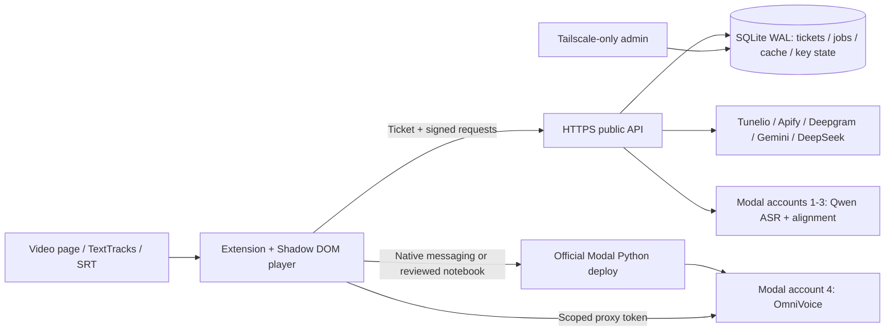

# Veloa architecture and implementation gates

Visible brand: **Veloa**, revised on 2026-11-03 at the owner's request. Internal
`auvirel` identifiers remain stable for service, storage and native-host compatibility.
See `DESIGN_REVISION.md` for reference comparison, brand search evidence and UI checks.

## Decisions grounded in research

Use two separately pinned GPU images: qwen-asr 0.0.6 requires transformers 4.57.6,
whereas omnivoice 0.2.1 requires transformers >=5.3.0. Combining them breaks dependency
resolution. Backend VPS remains CPU-only ARM64; GPU images run on Modal hardware.

Official model listing confirms Gemini `gemini-3.5-flash-lite` and `gemini-3.8-flash`.
DeepSeek's available IDs are `deepseek-flash` and `deepseek-v4-pro`; basic translation
maps to `deepseek-flash`. Preserve model catalog and explicit admin mappings; do not
silently change to a differently priced model.

Qwen ASR supports Vietnamese. Qwen ForcedAligner supports only 11 listed languages,
excluding Vietnamese. Use bounded Silero speech chunks, Qwen recognition, Qwen alignment
for supported languages and stable-ts/Whisper-small text alignment for Vietnamese. Validate timestamps
against audio duration and monotonicity; never manufacture evenly spaced word timestamps.
Unsupported alignment languages must have a documented alternative or explicit error.

Modal's JavaScript SDK is documented for server-side Node/Deno/Bun and cannot define
Functions. Browser deployment therefore needs a Python execution bridge. Preferred
local bridge: extension Native Messaging host invoking the official Python SDK with
client tokens in the child process environment, strict operation schema and fixed
worker source. Alternative: a reviewed Colab deployment notebook. The backend must
never receive account-4 credentials. Extension calls client TTS endpoint directly.

## Components and boundaries

Public and admin FastAPI applications run on separate listeners. SQLite transactions
and durable job leases avoid adding Redis solely for a small single-VPS deployment.
Persist jobs before returning 202; clients poll bounded job endpoints so MV3 service
worker termination cannot lose long GPU or ASR work. UI/audio lives in content pages,
not the service worker. Chrome and Firefox receive different MV3 background manifests.

ASR acquires media only when captions/SRT are unavailable. YouTube passes a Tunelio
public URL directly to Deepgram in fast mode. Other platforms download to bounded VPS
spool first, then upload. HQ mode normalizes audio to mono 16 kHz and sends bounded
speech chunks to the backend Modal account. Do not store video when audio suffices.

## Security contract

- Random high-entropy tickets stored as keyed hashes. Atomic first activation; absolute
  expiry stored in UTC. Recheck revocation/expiry on every protected request and job step.
- Short-lived server-signed session tokens plus a per-session request key. Sign method,
  canonical path/query, body SHA-256, timestamp and nonce. Atomically consume nonce;
  clock tolerance is bounded. Timestamp alone does not stop replay.
- Stable idempotency keys for costly jobs; retries get fresh nonces but the same logical
  idempotency identity. Single-flight cache misses prevent concurrent duplicate spend.
- IP and ticket limits; trust forwarding headers only from the configured loopback
  reverse proxy. Login brute-force limits apply before ticket validity is known.
- All provider secrets encrypted at rest; master key outside DB/repository, mode 0600.
  No request-body/provider-error logging, secret URLs or raw HAR in Git.
- Separate key states: available, invalid, depleted, cooling_down, forbidden. 429 is
  generally temporary; 403 may be permissions, not exhausted funds. Honor Retry-After,
  bounded exponential backoff and a total request deadline. Never retry all keys forever.
- HTTPS URL allowlist, resolve and reject nonpublic IPs at each redirect, restrict
  redirects/ports, prevent DNS rebinding, and never forward cookies/provider authorization
  to redirected media hosts. Bound response size even without Content-Length.
- Untrusted subtitles are plain text; no HTML execution. Preserve numeric cue IDs and
  timestamps independent of LLM output. Validate exact translation ID coverage.
- Modal proxy authentication rejects unauthenticated requests before GPU initialization.
  Client stores only its own scoped TTS token; deployment credentials never enter a page
  bridge or synchronized storage. Native host accepts fixed deploy/config actions, no shell.

## Storage and cost controls

Observed VPS disk total: 206,900,281,344 bytes (~192.7 GiB), not 200 GiB. Existing
provisioned capacity is fixed; this project must never resize disks or provision extra
volumes. Filling a filesystem causes write failures; billing depends on provisioned
Oracle resources, backups and other metered services, not an automatic app-level expansion.

Initial application limits: 8 GiB temporary media total, 4 GiB subtitle/translation
cache, 1 GiB bounded logs, two concurrent media jobs, 512 MiB input per download.
Reserve at least 30 GiB free and stop admitting jobs if root usage exceeds 80%.
Reserve disk bytes transactionally before work; stream downloads with actual-byte
enforcement. Delete owned temporary files in finally blocks, recover orphan job dirs
after crashes, expire cache by LRU/TTL and vacuum/checkpoint the DB on a schedule.
Never delete unrelated files, active job inputs, original references or external volumes.
Do not retain dubbed audio on the VPS: bounded IndexedDB cache belongs to the client.

GPU: min_containers=0, max_containers=1 per account/function, scaledown_window=30,
bounded execution time, no periodic GPU keepalive. Reuse weights on Modal Volume with
revision pinning; benchmark CPU/GPU snapshot options before claiming an improvement.
GPU snapshots are alpha and are optional, not a reliability prerequisite.

Use provider balances when exposed, otherwise usage reservations with explicit unknown
state. Modal monthly usage != remaining free credit. Verify workspace budgets/spend
limits before unattended workloads; never assume an exhausted credit returns 402 if
the workspace allows paid overage. Small benchmarks are bounded; no paid account upgrade.

## Playback and UI contract

One immutable voice selection per active generation epoch. Changing voice retains
translation and invalidates only relevant audio lookahead. Audio key includes translation
content hash, voice reference hash, model revision, synthesis parameters and DSP version.
Store compressed bytes in IndexedDB, decoded audio only near the playhead, with byte LRU.

Lookahead is a time window, initially 30-60 seconds with capped cue count and two in-flight
jobs. Seek cancels queued work, increments epoch, stops stale playback, reorders lookahead
and reuses completed clips. A missing current cue enters visible buffering; it is not
silently skipped. Pause/end/stop stops prefetch to permit GPU scale-down.

Trim low-energy leading/trailing silence conservatively, retain consonants/breaths,
apply 5 ms boundary fades and fit duration with pitch-preserving time stretching.
Do not concatenate speech across overlapping cues. Bound stretch ratios; if speech
cannot fit intelligibly, expose an explicit playback policy rather than truncating words.
Original audio, dub and optional BGM have independent gains and baseline restoration.

Apple-inspired, not an assertion of native Apple components: translucent controls above
stable opaque reading surfaces, restrained cool blue accent, custom SVG monogram/icons,
consistent spacing and radii, clear keyboard focus and 44 px primary hit targets.
Avoid glass behind dense transcript text. Respect reduced motion/transparency and contrast.
Popup for session/setup; injected panel for transcript, timestamp summary and grounded
chat. Animate short state transitions; no perpetual decorative motion.

## Implementation sequence and release gates

1. Evidence audit: local source/HAR/notebooks/forum/provider checks, provenance and limits.
2. GPU PoC: separate images; real T4/L4 cold/warm ASR/TTS, timestamp correctness, concurrency,
   memory and cost; choose default only from results. Record failures, not fabricated numbers.
3. Backend core: validation, DB/migrations, authentication, replay/idempotency, key rotation,
   disk guard and deterministic tests before provider wiring.
4. Provider workflows: real media, ASR/alignment, contextual translation, cache, summary/chat;
   measure and cap spend; test cancellation and provider outages.
5. Admin: private listener, ticket lifecycle, key imports/status, usage/cache/jobs/system stats.
6. Extension: dual manifests, secure settings, subtitle adapters, audio cache/scheduler/mixer,
   single-voice clone/presets, polished Shadow DOM UI, summary/chat and native deploy bridge.
7. Deployment: ARM64 non-root services, public TLS, private admin, SSH socket/service binding
   only after verified Tailscale access; backup current config and automatic rollback guard.
8. Acceptance: per-feature and integrated matrix, live browsers and human audio QA. No
   release claim until both browsers and actual providers pass or remaining limits are named.
