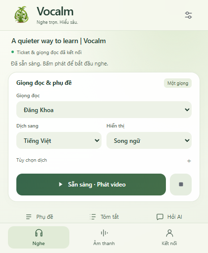
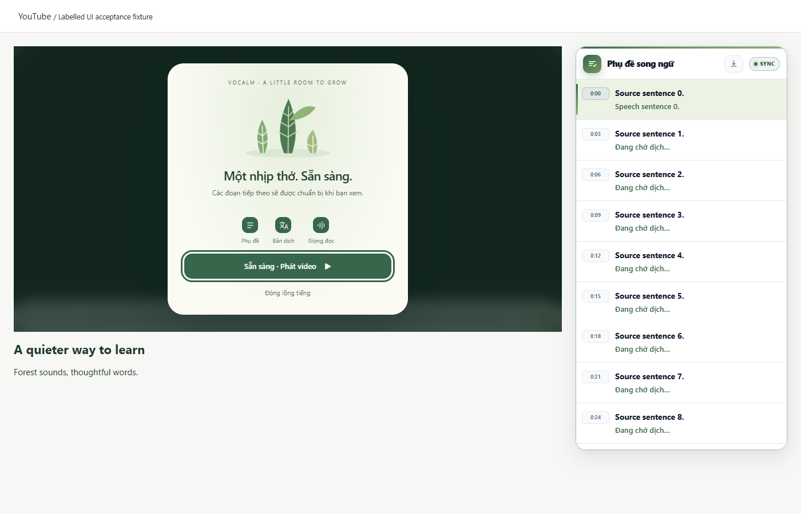
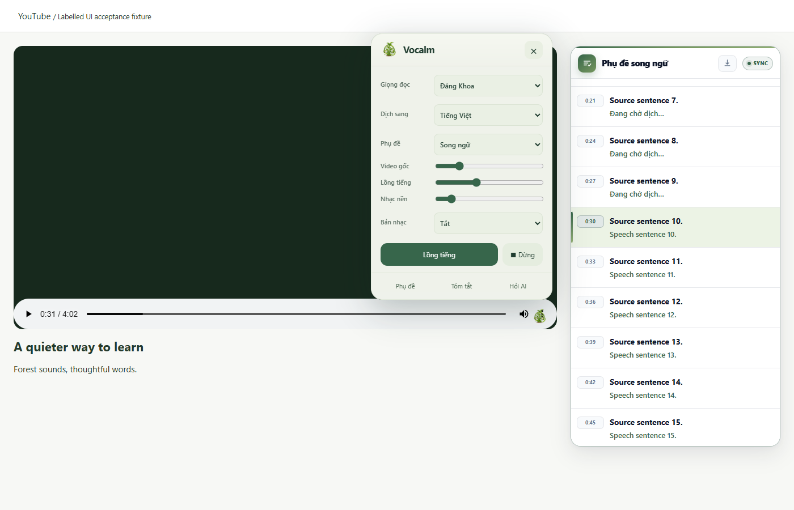

# Vocalm: player and visual revision

## Scope and sequence

1. Fix incremental transcript rendering without scroll resets.
2. Preserve the logical YouTube session across advertisements; suspend voice,
   music and lookahead while advertisements own the player timeline.
3. Gate initial playback with honest caption/translation/voice stages, explicit
   Ready action, cancellation and accessible reduced-motion bamboo artwork.
4. Add a YouTube control button with compact in-player settings. Rebrand the
   action popup and settings as Vocalm using the owner's bamboo/headphone image.
5. Verify with actual MV3 browser fixtures, live YouTube layout, screenshots,
   audio regression tests, builds and secret scan before packaging.

## Visual system

- Forest ink #203D30, primary fern #37664B, secondary #596C60, cream #F6F8F1,
  pale sage #E5EDDF, warm paper #FDFEF9. Text contrast is measured in acceptance.
- Native Apple-oriented font stack, generous rounded surfaces, restrained blur,
  44px main actions, labelled icon buttons and visible keyboard focus.
- Three small bamboo shoots grow as stages advance. Leaves breathe while working;
  they are decorative, never a fabricated progress percentage. Reduced motion
  removes looping/growth effects. Ready requires an explicit user gesture.
- Compact popup views: listening, sound, account/settings. Controls retain their
  state while switching views. Detailed provider setup stays within the popup.
- Keep internal IDs/storage/native bridge compatible; change public brand only.

## Acceptance gates

- In-place translation update appears without wheel/scroll, retaining scroll and
  highlighted cue. Virtualized transcript remains bounded.
- Same-video ad start/end, source swap and video-element replacement preserve
  cue count/job; no audio or background translation during ads. Real navigation
  clears old content. Ads remain playable even during preparation.
- Preparation rejects play/keyboard bypass; Ready starts playback; Cancel and
  errors unlock. Seeks while preparing/ready use the new position.
- Popup and player menu: all controls wired, no horizontal overflow, focus/Escape,
  light/dark host, narrow viewport, fullscreen, reduced motion.
- Chrome/Firefox packages, JS/Python regressions, labelled browser fixtures and
  screenshots. Live midroll delivery is nondeterministic: fixture evidence must
  not be described as live advertisement verification.

## Acceptance results

All functional gates above passed the labelled Chrome browser harness, including
ad source/node swaps, initial and Ready playback locks, new seek preparation,
advertisements during preparation, provider errors, fullscreen, narrow layout and
reduced motion. Initial request/synthesis stays bounded to one sentence.
Live Chrome/Firefox service playback and the real YouTube player-control/layout
checks also pass. Core regression suite: 58 Python and 41 JavaScript tests.

The action popup was captured at the browser's actual 420x510 available viewport;
its bottom navigation remains visible. Settings use expandable groups within the
same popup. Core text/action contrast measures 5.25:1 to 11.07:1. Screenshots were
visually reviewed and corrected for clipped navigation and inherited page fonts.

Screenshots are labelled fixture content, with no account secrets:

Remaining limits: real midroll ad delivery was not forced/verified, native VIDEO
fullscreen cannot host injected DOM, and subjective audio quality/long-video soak
testing remain the earlier release's open gates. No new latency claim is inferred
from the provider fixtures.
